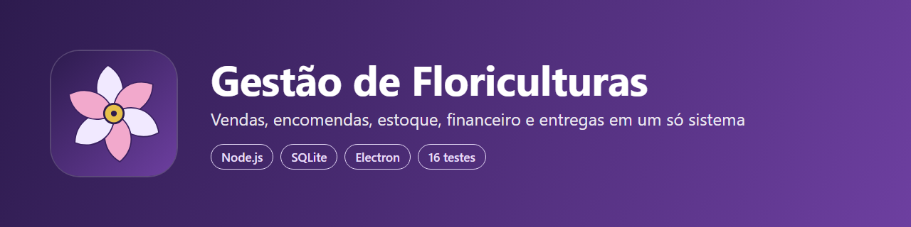

# Gestão de Floriculturas



Sistema para Windows que reúne vendas, encomendas, clientes, catálogo, fichas técnicas, estoque, financeiro, entregas e relatórios de uma floricultura, com login e perfis de acesso.

Destaques: dinheiro guardado em centavos, baixa de estoque na venda, validação de CPF, bloqueio após 5 senhas erradas e cópia de segurança automática.

## Tecnologias

Node.js, SQLite (embutido no Node), HTML, CSS, JavaScript e Electron.

## Como rodar

```
npm install
npm start        # abre o programa; há um modo de demonstração na tela de entrada
npm run servidor # só o servidor, em http://localhost:8686
npm test         # 16 testes automatizados da API
npm run check    # confere a sintaxe
```

## Autoria

Desenvolvido por Dayane Ferreira, com apoio de IA. Código publicado para avaliação do meu trabalho. Todos os direitos reservados.
