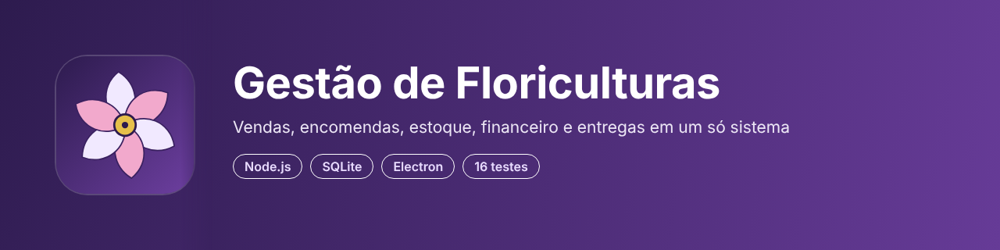
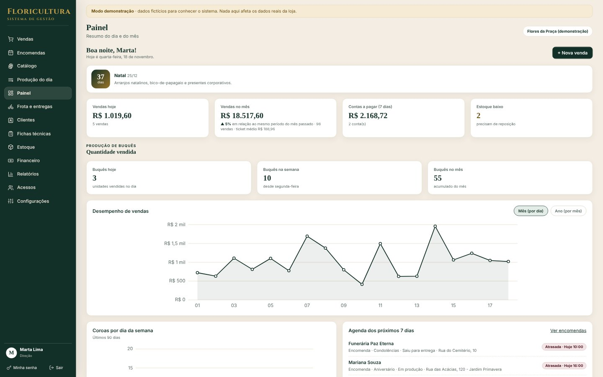
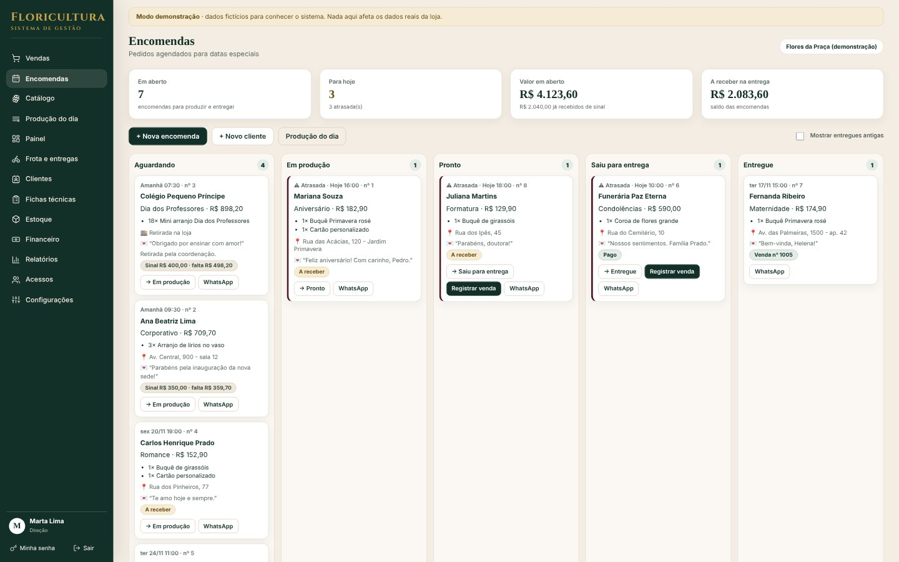
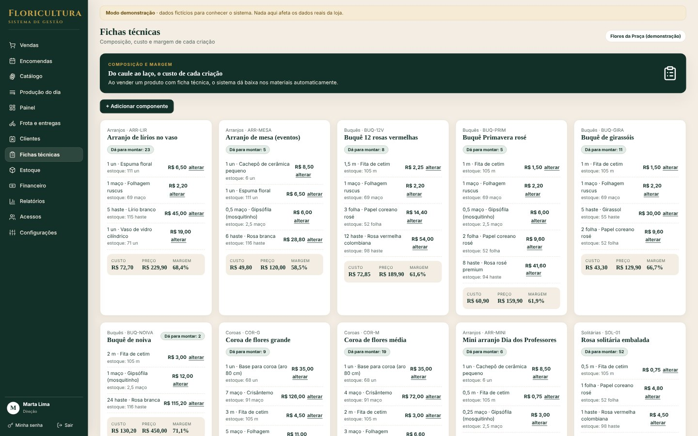

# Gestão de Floriculturas



[](https://github.com/desenvolvimentodayaneferreira/gestao-de-floriculturas/actions/workflows/testes.yml)


Sistema de gestão para floriculturas: vendas no balcão, WhatsApp e telefone, encomendas, produção do dia, catálogo com fichas técnicas, estoque, financeiro, entregas e relatórios. Funciona sem internet, com o banco de dados embutido no próprio programa.

> **In English:** a desktop management system for flower shops (sales, orders, production, recipes/bill of materials, inventory, finance and deliveries). Node.js HTTP API + SQLite + vanilla JS front-end, packaged with Electron. 16 automated API tests run on every push (GitHub Actions).

## Telas

| Painel do dia | Encomendas por etapa | Fichas técnicas |
|---|---|---|
|  |  |  |
| Vendas, contas a pagar, estoque baixo e próximas datas comemorativas. | Aguardando → em produção → pronto → saiu para entrega → entregue. | Custo de cada arranjo e margem calculados automaticamente. |

## O que o sistema faz

- **Vendas** com cliente pelo CPF (validado), canal, retirada ou entrega, desconto e comprovante; o cancelamento devolve o estoque.
- **Encomendas** com sinal e saldo, mensagem do cartão e aviso à cliente pelo WhatsApp com texto pronto.
- **Produção do dia**: o que montar, materiais necessários × estoque e lista de compras.
- **Fichas técnicas**: cada venda dá baixa nas matérias-primas (rosas, folhagens, fitas…) automaticamente.
- **Financeiro**: lucro do mês, contas a pagar e despesas fixas; **relatórios** por período com exportação para planilha.
- **Acessos**: perfis com permissões ajustáveis e registro de quem fez o quê.

## Como foi construído

```
web/        telas (HTML, CSS e JavaScript, sem framework)
   │  fetch (JSON)
servidor/   API HTTP em Node.js: rotas, regras de negócio e permissões
   │
SQLite      banco embutido (node:sqlite), um arquivo por loja
electron/   empacota tudo como programa para Windows
testes/     testes automatizados da API (node:test)
```

Decisões técnicas:

- **Dinheiro guardado em centavos** (inteiros), para não haver erro de arredondamento.
- **Regras no servidor**, nunca só na tela: estoque, permissões e cálculos ficam na API.
- **Sem dependências no back-end**: Node.js 22 já traz HTTP, SQLite e o executor de testes.
- **Só atende o próprio computador** (`127.0.0.1`): nenhum outro aparelho da rede acessa os dados.

## Segurança

- Senhas guardadas com **scrypt** e sal individual (nunca em texto).
- **Bloqueio após 5 senhas erradas** e sessão que expira por inatividade.
- Primeiro acesso cria o administrador: **não existe senha de fábrica**.
- Cópia de segurança automática diária e restauração pelo próprio sistema.

## Como rodar

Pré-requisito: [Node.js 22](https://nodejs.org/) ou mais novo.

```bash
git clone https://github.com/desenvolvimentodayaneferreira/gestao-de-floriculturas.git
cd gestao-de-floriculturas
npm test               # roda os 16 testes (não precisa instalar nada antes)
npm install            # só para abrir o programa completo
npm run exemplo        # cria uma floricultura de exemplo em ./dados-dev
npm run servidor       # API + telas em http://localhost:8686
npm start              # programa completo (Electron)
```

Na tela de entrada há o botão **Conhecer com dados de demonstração**, que monta uma loja fictícia com 6 meses de movimento.

## Testes

`npm test` roda **16 testes automatizados** da API, que sobem o servidor com um banco temporário e conferem:

- validação de CPF pelos dígitos verificadores;
- primeiro acesso sem senha de fábrica e servidor que só atende o próprio computador;
- usuários, perfis, permissões, **bloqueio após 5 senhas erradas** e troca de senha;
- venda que dá baixa nos materiais pela ficha técnica e cancelamento que devolve o estoque;
- encomenda com sinal que vira venda; frota e fechamento de entregas;
- financeiro (despesas, contas a pagar, lucro do mês), painel e relatórios;
- cópia de segurança e registro de ações.

Os testes rodam sozinhos a cada envio de código pelo **GitHub Actions** (selo "Testes" no topo).

## Autoria

Desenvolvido por **Dayane Ferreira**, estudante de Engenharia de Software, com apoio de IA no desenvolvimento e nos testes. As regras de negócio, a validação com o uso real e a publicação são minhas.

Código publicado para avaliação do meu trabalho. Todos os direitos reservados.
